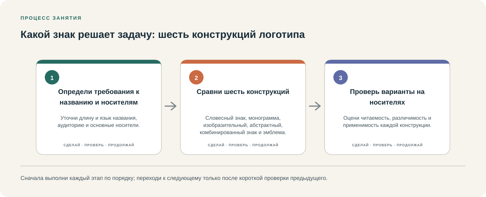
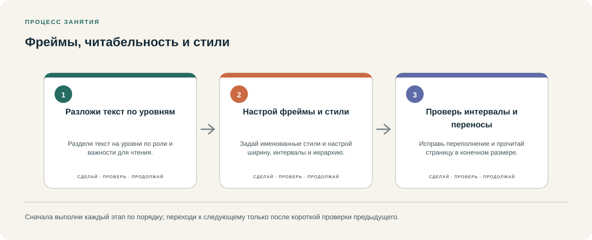
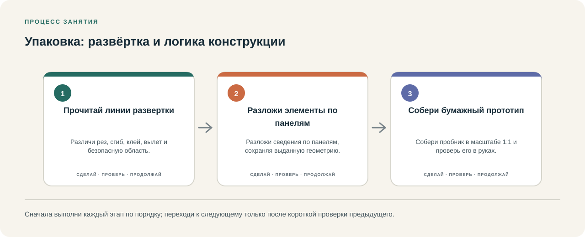

# Пакет пилотных занятий: три проверки понятности курса

**Статус: студенческий пилот ожидает участия 2–3 студентов.** Ниже подготовлены три занятия для проведения; пока они не проверены с участниками. Здесь приведены проектные задания колледжа, а не официальное задание или оценка WorldSkills. Материалы Казахстана 2026 года и WSI 2026 года дают временные ориентиры; после официальной публикации условий 2027 года преподаватель сверяет и меняет только затронутые части.

Проведите каждое занятие одинаково для всех участников: одинаковый бриф, время, устройства и доступные файлы. Сначала прочитайте условия вслух и спросите, как студент понял цель; не объясняйте шаги заранее. Если участник просит помощь, используйте одну нейтральную подсказку: «Какой следующий шаг ты бы проверил?» Запишите, на каком месте и после какой подсказки работа продолжилась. Не превращайте пилот в отбор и не сравнивайте участников публично.

Пользуйтесь [листом наблюдения](pilot-observation-sheet.md). Записывайте только временный код, наблюдаемое действие и нужную помощь. Не вносите имена, контакты, публичные баллы или работы без согласия. Сохранение файла участника необязательно; если работа нужна для повторной проверки, сначала получите согласие и храните её приватно.

## 1. Логотип и выбор концепции — 55 минут

Связанные занятия: [01-symbol-context](../module.html?id=01-brief), [03-logo-typologies](../module.html?id=03-illustrator), [03-identity-system](../module.html?id=03-illustrator).

**Цель.** Научиться извлекать из брифа смысл и аудиторию, предложить разные идеи знака, выбрать одну по критериям и проверить её в одном цвете и малом размере.

**Длительность.** 55 минут.

**Бриф.** Придуманный колледжем проект «Аула Lab» приглашает молодёжь и жителей района на мастерскую ремонта и повторного использования вещей. На макете должны быть название «Аула Lab» и пояснение «Мастерская ремонта и повторного использования». Идея должна передавать совместную практическую работу и бережное отношение к вещам. Это гипотезы для проверки, а не универсальные значения символов. Не добавляйте обещаний о сертификации или экологическом эффекте.

**Материалы.** Этот текст, бумага и карандаш; по возможности — компьютер с установленным Illustrator. Для проверки размера используйте линейку и нарисованную рамку 24 × 24 мм. Интернет и цветной принтер не требуются.

**Порядок работы.**

1. За 5 минут своими словами сформулируйте цель, аудиторию, обязательные надписи и одно ограничение.
2. За 8 минут запишите три смысловых направления. Для каждого укажите, почему оно может подойти аудитории и что может быть понято иначе.
3. За 12 минут сделайте три заметно разные миниатюры: вариант со словом, вариант со знаком и комбинированный вариант. Не полируйте контуры.
4. За 15 минут выберите одно решение и уточните его на бумаге или в Illustrator. Сохраните читаемость точного названия.
5. За 8 минут проверьте знак чёрным по белому и в рамке 24 × 24 мм; отметьте, какая деталь исчезла или стала неразборчивой.
6. За 7 минут устно объясните выбор: какое требование он решает, какую гипотезу о смысле нужно проверить и что вы изменили бы после обратной связи.

**Что наблюдать.** Может ли студент без подсказки назвать цель? Отделяет ли он обязательную надпись от идеи? Различаются ли три направления? Объясняет ли он, что символ может получить разные значения в разных контекстах? Проверяет ли малый размер, а не только увеличенный экран?

**Критерии.** Отметьте «самостоятельно», «после подсказки» или «пока не проверено»: требования брифа выделены; три концепции различаются; выбор связан с аудиторией и критерием; название читается; проверены монохромный вариант и малый размер; объяснение содержит гипотезу, а не выдаёт её за факт.

**Запасной маршрут.** Если Illustrator недоступен или контуры мешают работе, нарисуйте три концепции в одинаковых рамках; допускаются круги, прямоугольники, простые линии и рукописная надпись. Сохраните различие идей, объяснение выбора и проверку размера. Отдельно запишите, что владение программой этим маршрутом не проверялось.

**Разбор.** Спросите: «Какое требование было труднее всего выделить?», «Что помогло отказаться от слабой идеи?» и «Кому и как вы покажете знак, чтобы проверить смысл?» Зафиксируйте точную строку инструкции, где потребовалась помощь.

## 2. Первая страница в InDesign — 50 минут

Связанные занятия: [02-document-grid](../module.html?id=02-indesign), [02-text-styles](../module.html?id=02-indesign).

**Цель.** С нуля создать одностраничный макет, расставить уровни текста, сохранить исходник и проверить экспортированный PDF.

**Длительность.** 50 минут.

**Бриф.** Сделайте учебное объявление об открытой мастерской. Весь обязательный текст уже дан, поэтому задача проверяет работу в InDesign, а не поиск содержания:

- ОТКРЫТАЯ МАСТЕРСКАЯ
- Суббота, 11:00–15:00
- Ремонт одежды • мелкой техники • обмен книгами
- Принеси вещь, которую хочешь починить.
- Культурный центр «Аула», аудитория 2

Формат A4 и поля 12 мм выбраны только для этого упражнения. Они не являются параметрами WorldSkills.

**Материалы.** Компьютер с установленной версией InDesign, локальная копия текста, лист с шагами занятия и папка для исходника и PDF. Подключение к интернету не нужно.

**Порядок работы.**

1. За 5 минут откройте новый документ: одна вертикальная страница A4, поля 12 мм. Если название команды отличается в вашей версии, ориентируйтесь на результат, указанный в шаге.
2. За 8 минут сохраните исходник как PILOT-02.indd в папку занятия. Создайте крупный заголовок и отдельный блок для даты.
3. За 12 минут добавьте остальной текст в отдельные текстовые рамки. Разместите их сверху вниз в порядке, в котором читатель должен заметить заголовок, время, занятие и адрес.
4. За 10 минут настройте два уровня текста и выравнивание. Если создание стилей пока замедляет первое занятие, примените форматирование вручную, а название пропущенной команды запишите для повторения.
5. За 8 минут проверьте, что текст помещается в рамки и не перекрывает соседние элементы. Сохраните исходник.
6. За 7 минут экспортируйте PDF, откройте его отдельно и сравните с исходным файлом: все ли строки присутствуют, нет ли обрезанного текста и верен ли формат страницы.

**Что наблюдать.** Может ли студент найти нужный инструмент по схеме? Понимает ли разницу между рамкой и текстом? Замечает ли переполнение до экспорта? Может ли сохранить и вновь открыть оба файла? Запишите, какие названия команд не совпадают с установленной версией.

**Критерии.** Отметьте «самостоятельно», «после подсказки» или «пока не проверено»: документ заданного учебного размера создан; обязательный текст сохранён полностью; уровни чтения различаются; исходник и PDF находятся в названной папке; PDF повторно открыт и проверен; трудность и версия программы записаны.

**Запасной маршрут.** Если InDesign не запускается, интернет отключён или интерфейс отличается, разложите текст на бумажных рамках, пронумеруйте порядок чтения и отметьте, какой файл нужно будет сохранить первым. Сохраните цель и логику иерархии; навык работы в программе пометьте «пока не проверено», а сбой запишите отдельно.

**Разбор.** Попросите показать один найденный и один ещё не найденный элемент интерфейса. Уточните, по какому признаку студент убедился, что PDF готов. Не подсказывайте заранее расположение панели или меню.

## 3. Упаковка и проверка печати — 60 минут

Связанные занятия: [05-dieline](../module.html?id=05-print-production), [05-proof-cycle](../module.html?id=05-print-production).

**Цель.** Разобрать панели и сгибы физической упаковки, разместить информацию с учётом этих ограничений, проверить PDF и честно отметить границы печатной проверки.

**Длительность.** 60 минут.

**Бриф.** Подготовьте учебную бумажную накладку для вымышленного «Набора Аула Lab» — набора материалов для мастерской повторного использования. На лицевой стороне нужны точное название и фраза «Учебный макет. Не для продажи». На боковой стороне разместите список: «бумага для эскизов», «карандаш», «инструкция». На обороте — три шага: «выбери вещь», «спланируй ремонт», «обсуди результат». Не придумывайте сведения о безопасности или свойствах продукта.

**Материалы.** Чистая пустая коробка или картонная упаковка для изучения панелей, линейка, карандаш, InDesign и обычная бумага. Для печати подойдёт доступный простой принтер или цветная печать в сервисе. Если образца упаковки нет, преподаватель заранее приносит один. Этот макет — учебный, не производственный шаблон.

**Порядок работы.**

1. За 8 минут найдите лицевую, боковую и оборотную панели на образце. Отметьте края, сгибы, клапан и область, которую нельзя перекрывать текстом.
2. За 8 минут измерьте панели и составьте карту размещения. Не выводите универсальные размеры безопасного поля: оставьте заметный отступ и пометьте его как решение этого упражнения.
3. За 18 минут создайте плоскую раскладку с обязательными надписями. Отделите зоны панелей и сгибов метками, которые не примут за часть дизайна; поставьте метки и линии в отдельный слой или удалите их перед финальным PDF.
4. За 8 минут экспортируйте PDF с фактическим размером страницы из вашей карты. Повторно откройте PDF и проверьте все надписи, отступы и линии.
5. За 10 минут распечатайте лист в масштабе 100%, если принтер доступен. Приложите или согните пробный лист вокруг образца, чтобы проверить размер, читабельность и положение текста относительно сгибов.
6. За 8 минут запишите, что именно проверено. Обычная печать может помочь проверить размер, обрезку, ошибки и сгибы, но сама по себе не является цветопробой; цвет без подходящей калиброванной процедуры отметьте как «не проверен».

**Что наблюдать.** Различает ли студент линию сгиба и реза? Измеряет ли реальный образец? Проверяет ли PDF отдельно от исходника? Ставит ли подпись и обязательный текст вне сгибов? Называет ли обычную печать черновой проверкой, а не подтверждением точности цвета?

**Критерии.** Отметьте «самостоятельно», «после подсказки» или «пока не проверено»: назначение панелей отмечено; обязательная информация присутствует; важный текст не пересекает сгиб; размер и экспорт проверены; известны границы пробной печати; непроверенный цвет явно обозначен.

**Запасной маршрут.** Если принтера нет, проверьте PDF и карту панелей на экране, обведите панели на бумаге по измерениям и запишите «размер на физическом отпечатке не проверен». Если коробки нет, используйте заранее принесённый образец преподавателя. Не заменяйте отсутствующий физический тест утверждением, что размер или цвет подтверждён.

**Разбор.** Попросите назвать один дефект, который можно найти на черновой печати, и один, который ею нельзя подтвердить. Спросите, что студент проверил бы повторно при смене размера или способа вывода.

## После занятий

Сразу после каждой пробы внесите в лист наблюдения действие, конкретное затруднение, вид подсказки и предложение по инструкции. Повторите только непонятный шаг и проверьте, устранила ли правка затруднение. До реального проведения статус остаётся «ожидает участия студентов»; материалы автоматически проверены, но это не заменяет наблюдение за учащимися.
